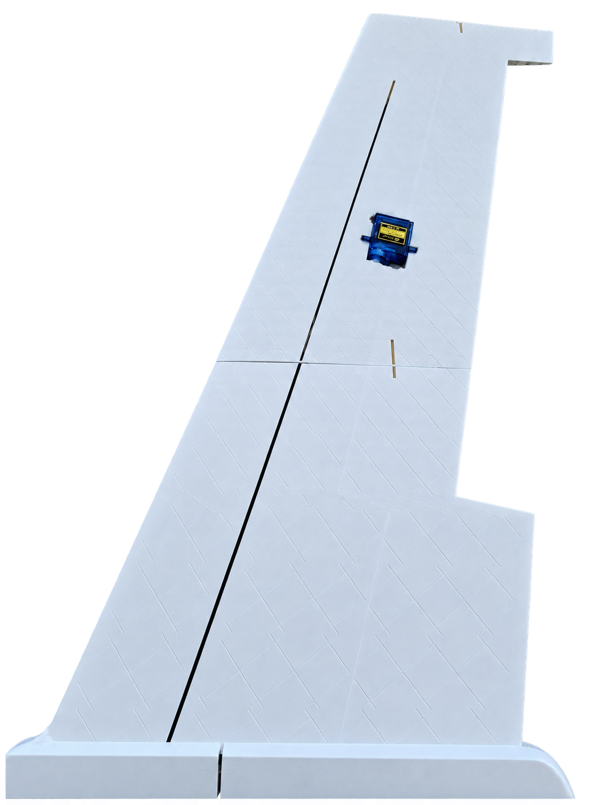
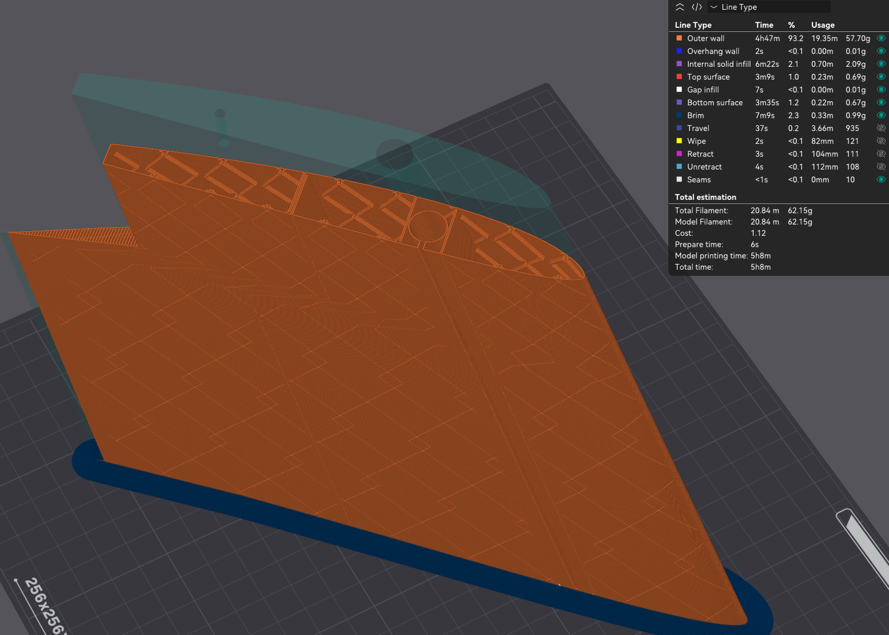

# Aircraft Structures for OrcaSlicer

A Python slicing-pipeline plugin for OrcaSlicer that adds internal reinforcement to
vase-mode aircraft wing prints. You give OrcaSlicer an ordinary **solid** wing
model; the plugin cuts narrow, boundary-connected slots into each sliced
cross-section so the single continuous perimeter detours inward and back, forming
webs beside the outer skin, without modelling those features in CAD.

> **Status: experimental research software.** It runs only in one specific
> OrcaSlicer nightly build (see [Tested host](#tested-host)), has been exercised
> on a small number of wings, and has **no structural measurement behind it**. It
> is not shown to work on arbitrary wings. Read [LIMITATIONS.md](LIMITATIONS.md)
> before relying on it.

<p>


</p>

*Left: physical print from an earlier development build; exact slicer settings not
recoverable. Right: OrcaSlicer preview of a wing sliced with the plugin (OrcaSlicer
estimates 62.15 g and 5 h 08 min for that model). The model in the screenshot is not
the one in `examples/`. A second print photo is at
[docs/img/printed-wing-installed.png](docs/img/printed-wing-installed.png) (same
caveat).*

## What it does

Standard vase mode prints a light, hollow shell with one continuous outer wall, but
it omits internal webs and spar sockets. Conventional slicing supports internal
geometry but can use far more material. This plugin works in between: it changes the
2D cross-section of every layer during slicing, so that Orca's own single Classic
perimeter and Spiral Vase handling produce a one-wall skin whose wall also traces
internal members.

OrcaSlicer's own estimates for one wing, as shown on the author's project page.
The table reproduces the figures in the page's updated slicer screenshots. The
plugin row matches the page's G-code export (same mass and time); the
conventional and vase rows do not: the earlier G-code exports behind the page's
interactive viewer show 151.86 g / 3 h 57 min and 43.52 g / 1 h 12 min, because
the screenshots use updated slicing settings. The three rows were not produced in
one controlled session, with the same plugin build or with identical process
presets (the conventional and vase runs used a stock preset, the plugin run used
the M1 Coupon preset), and no model identity is recorded here.

| OrcaSlicer estimates | Filament | Print time |
| --- | --- | --- |
| Conventional slicing | 175.79 g | 5 h 11 min |
| Standard vase mode | 43.52 g | 2 h 46 min |
| With the plugin | 62.15 g | 5 h 08 min |

These are slicer estimates, not weighed parts, and they say nothing
about strength: standard vase mode is lighter and faster precisely because it omits
the internal structure.

## How a solid wing becomes one perimeter with internal reinforcement

1. Orca slices the solid STL normally.
2. At the `posSlice` step the plugin receives each layer's cross-section polygon.
   It measures that layer's real local geometry and decides where members go.
3. For each member it subtracts a **narrow slot** (about 0.02 mm wide in the shipped configs, which is 5% of a 0.42 mm wall) that starts on the exterior boundary and runs inward, stopping short of the
   far skin by a margin. Nothing is added; structure is made by removing material.
4. A validator re-measures the result from the actual cut geometry and requires
   **exactly one island and no holes** for every cut layer.
5. The plugin hands the edited polygons back (`slices.set(...)`, then
   `layer.make_slices()`). Orca generates one Classic perimeter around the new
   outline and **Spiral Vase** turns the part into one helical extrusion.
6. The wall dives in along one side of a slot, turns at the end, and comes back out
   along the other. The two adjacent traces are expected to fuse into a web about
   one bead thick; the fusing gap was observed on small printed PLA coupons
   (0.021 mm fused, 0.105 mm and wider did not bond).

A member is a stack of per-layer webs, so everything the method can build runs
spanwise (possibly drifting sideways with height). Chordwise ribs and enclosed cells
are not possible: they would split the section or add a second loop.

### The single-perimeter rule and what happens when it cannot hold

Every transformed body layer must stay **one closed loop**. When a cut that was
made would sever the section, enclose a hole, miss the boundary, or leave too little
skin, the slice **fails** with a message naming the layer index, Z height and
cause. Cancelling a slice returns without error. Some situations are deliberately
**not** failures: a web that cannot be placed is omitted, a layer too thin or
pinched to carry structure is printed as plain skin, and the root and tip ends are
handled specially. All of those are recorded in a per-run report. See
[LIMITATIONS.md](LIMITATIONS.md) for the exact list. The continuity checker that
accompanies the experimental Z-continuity option is **report-only**: it never
rejects a slice.

For how the pieces fit together, see [docs/architecture.md](docs/architecture.md).

## Source layout: modular source, generated bundle

```
aircraft_core/                 pure geometry (no Orca imports), unit-testable
plugin/aircraft_structures/
    capability.py              the Orca-facing edge
    aircraft_structures.py     GENERATED single-file bundle: this is what gets installed
tools/build_plugin.py          builds the bundle
```

OrcaSlicer installs exactly one entry file per plugin, so `tools/build_plugin.py`
flattens `aircraft_core` and `capability.py` into one file, deterministically (same
inputs, same bytes), and puts a content hash of the bundled code in its header. The
plugin writes that hash into every report. **Never edit the bundle by hand.** Edit
the sources and run `python tools/build_plugin.py`; a test fails if the checked-in
bundle does not match its sources.

The checked-in bundle (LF line endings, enforced by `.gitattributes`) has
sha256 `fb5825687dc81154fa674d0099cf6b93a1d95c3ebb70b6ddc7c35e1b5acc2b8b`
and embedded content hash
`54ea6a33ac9f29328fa09a7bb3614b31501089c00cb57e3af3df30ce21ec57c9`.

## Tested host

The plugin system exists only in OrcaSlicer `main`-branch nightlies, not in any
stable release through v2.4.2. This snapshot was tested with exactly one host:

| Item | Value |
| --- | --- |
| Build | OrcaSlicer Windows x64 nightly, portable zip (`OrcaSlicer_Windows_x64_nightly_portable.zip`) from the rolling `nightly-builds` release |
| Asset date | 2026-08-22 |
| Zip SHA-256 | `1283a196b2e5ed14d05123645706acbe31b0665cfc671887db0e61ef5bf6595a` (227,528,542 bytes) |
| Source commit | `550e234a37a408c7f2b8ca6dd3fe6c42f912a0eb`, **inferred, not proven**: the binary embeds no commit string; the asset was published about an hour after that commit |
| Self-reported version | `2.5.0-dev` |

The plugin API used here was read from the OrcaSlicer source at that commit, by
blob SHA (`RESEARCH_SOURCES.md`). **Stable releases and other nightlies are
untested**, and `nightly-builds` is a rolling tag; this build is not expected to still be served.
Everything else about the host is in [INSTALL.md](INSTALL.md).

## Quickstart

Short form; [INSTALL.md](INSTALL.md) has the details, the exact script behaviour and
how to confirm the plugin ran.

1. Get the tested host and extract it to `host\orca-nightly\OrcaSlicer\`.
2. Launch it with `powershell -File tools\run_host.ps1` (always an isolated
   `--datadir`, plus its own WebView2 folder).
3. Install `plugin\aircraft_structures\aircraft_structures.py` through the
   **Plugins window** (hand-copying does not work), activate it, and create the
   empty arming file `m1_enabled` next to it.
4. Copy a process preset that carries `slicing_pipeline_plugin` and `plugins` into
   the host's user preset folder and select it.
5. Install a config: `python tools\config.py use default_config.json`, restart.
6. Slice **in the GUI**. Command-line slicing does not load the plugin.

A plugin that is "visible" or "enabled" has not necessarily run. Check the report
file as described in INSTALL.md.

## Example

[`examples/wing_custom/`](examples/wing_custom/README.md): a tapered wing half
with a thin flat trailing edge, plus the exact plugin config and process preset used
for one in-host slice, the run's summary (1000 layers seen, 995 mutated, 0 failed),
a second in-host slice of the wing's root half made from this snapshot with its
exported G-code, and steps to reproduce. That example's config enables the
experimental `z_continuity` option. **No physical print exists for it.**

## Main configuration options

Configuration is a JSON file, `orca_plugins/config.json` in the host's data
directory, managed with `python tools/config.py` (`list`, `use`, `show`, `check`,
`set`). Tracked starting points are in
[`presets/plugin/`](presets/plugin/README.md). The full key reference is
[docs/configuration.md](docs/configuration.md) (generated from the schema). The
keys you will reach for first:

- `families`: the member patterns. Each has a `role` (`skin_lattice` or
  `primary_structure`), a chord position (`web_position`), a pitch
  (`rib_pitch_mm` or chord-relative `rib_pitch_chord_frac`), a depth
  (`web_depth_mm`, shallow or full), the skin it enters from (`entry_lower`), and
  optional drift with height (`z_drift_mm_per_mm`, `z_period_mm`) that makes
  diagonals.
- `gap_ratio` or `slot_gap_mm`: slot width (the web-fusing gap).
- `skin_margin_mm`: skin left between a web's far end and the far surface; must
  exceed twice the wall line width.
- `root_solid_layers`, `root_end` (`auto`, `bed`, `top`).
- `spar_station`, `spar_clearance_mm`, `spar_neck_width_mm`, `spar_channel_policy`:
  the carbon-rod socket, which is taken from a channel modelled in the CAD part.
- `z_continuity` (**experimental**, off by default in the code; the shipped live
  preset and the example turn it on), `tip_alignment_skip_enabled`,
  `mesh_alignment_tolerance_mm`.

Defaults that are on without any switch, and have no physical validation, include
opposing-pair ablation, pinched-section shutdown, and the root-end `auto` handling;
see LIMITATIONS.md.

## What has and has not been demonstrated

| Evidence | Status |
| --- | --- |
| Geometry validation (offline) | 1506 automated tests pass in the snapshot's test environment |
| Offline replay of models | Available (`tools/preflight_wing.py`) |
| Fake-host integration tests | Pass; the fake host covers limited geometry |
| In-host GUI slicing | Done on the author's machine. From this snapshot: first install through the Plugins window, activation, and one slice of the example's root half with G-code export (2026-10-27, see the example) |
| Physical printing | Earlier builds only; settings not recoverable; none for the example |
| Structural measurement | **None** |

[TESTING.md](TESTING.md) explains each level and how to run the suite
(`python tools/run_tests.py`, Python 3.11, `requirements-dev.txt`).

## Limitations

See [LIMITATIONS.md](LIMITATIONS.md): geometry (thin flat trailing edges, blunt
mid-span, pitch-collapsed sections, mesh top, root and tip ends), host
(nightly-only API, no CLI support), testing and printing limits, and the absence of
structural measurement.

## Attribution

The underlying vase-mode technique builds on approaches demonstrated by
**Tom Stanton** ([YouTube](https://www.youtube.com/watch?v=QJjhMan6T_E)), who used
narrow cuts in CAD geometry to generate internal wing ribs. This plugin automates
the geometry modification during slicing. Other prior art and all sources consulted
are listed in [RESEARCH_SOURCES.md](RESEARCH_SOURCES.md). Deneb's tool was used as
requirements evidence only; no third-party source code is included.

OrcaSlicer is AGPL-3.0 software; this repository does not include or redistribute
it.

## Licence

Copyright (C) 2026 Kai Keller. Licensed under the GNU Affero General Public License
v3.0; see [LICENSE](LICENSE).
